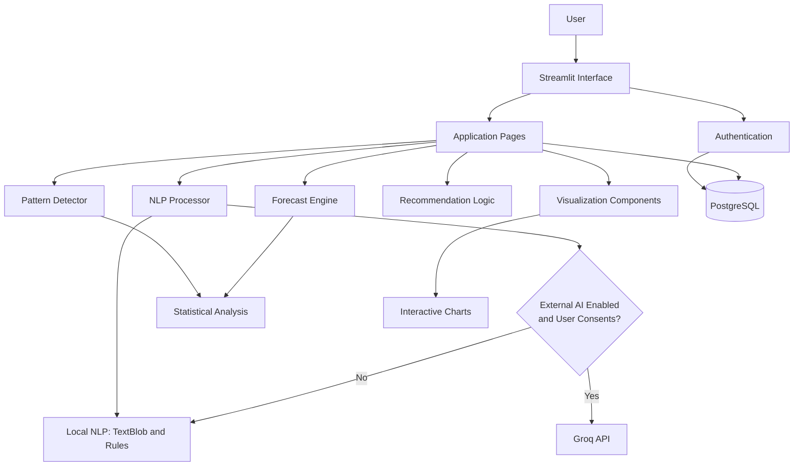

# LifePatterns AI

A personal behavior and wellbeing analytics application built with Streamlit, PostgreSQL, local natural language processing, statistical pattern detection, and optional external LLM inference.

## Overview

LifePatterns AI helps users organize daily journal entries and explore relationships between their mood, energy, sleep, and activities. It combines structured self-tracking with NLP-based text analysis and rule-based analytics to generate insights into behavioral trends.

The application is designed for personal reflection and self-improvement. Its outputs are exploratory and should not be interpreted as medical diagnoses, validated clinical assessments, or guaranteed predictions of future wellbeing.

**Primary users:** Individuals interested in journaling, habit tracking, and personal wellbeing analytics.

**Primary goal:** Turn daily observations into understandable trends and practical opportunities for reflection.

**Implementation status:** Core application features and unit tests are implemented. Production readiness, comprehensive security hardening, and end-to-end verification remain separate concerns.

## Problem

Daily journaling and mood tracking can produce useful personal information, but recognizing patterns across multiple entries can be difficult.

Common challenges include:

- Identifying changes in mood and energy over time.
- Exploring possible relationships between sleep, activities, and mood.
- Organizing journal entries alongside structured daily measurements.
- Turning historical observations into useful questions for self-reflection.
- Presenting personal tracking data through understandable visualizations.

## Solution

LifePatterns AI provides a unified application for:

1. **Daily tracking:** Record mood, energy, sleep duration, activities, and journal text.
2. **Text analysis:** Extract sentiment, emotions, keywords, and topics using local NLP and optional external AI.
3. **Pattern discovery:** Examine mood trends, sleep–mood relationships, and activity-related differences.
4. **Wellbeing exploration:** Present rule-based trend projections and related observations where supported by the application.
5. **Recommendations:** Provide suggestions through rule-based logic and optional AI-generated content where implemented.
6. **Reporting:** Explore historical entries, summary statistics, and interactive visualizations.
7. **Data management:** Store user entries in PostgreSQL and support JSON data export.

These features support personal reflection. Observed correlations do not establish causation, and forecasts are not guarantees.

## Architecture

The application follows a modular Python architecture with a Streamlit interface, application-level processing components, and a PostgreSQL persistence layer.



### Component responsibilities

- **Streamlit interface:** Renders pages and manages interactive application state.
- **Authentication:** Handles user registration, login, and session-related functionality implemented in the application.
- **NLP processor:** Analyzes journal text using local processing and optionally an external LLM.
- **Pattern detector:** Examines historical measurements for trends and potential relationships.
- **Forecast engine:** Applies implemented forecasting logic to historical observations.
- **Recommendation logic:** Produces suggestions using supported rule-based or AI-assisted paths.
- **Visualization components:** Present historical measurements and analytical outputs.
- **Database layer:** Stores application data in PostgreSQL through the configured database access layer.

For more detail, see [docs/architecture.md](docs/architecture.md).

## Tech Stack

| Area                   | Technology                            |
| ---------------------- | ------------------------------------- |
| Language               | Python                                |
| User interface         | Streamlit                             |
| Database               | PostgreSQL                            |
| ORM                    | SQLAlchemy                            |
| External LLM inference | Groq API, optional                    |
| Local NLP              | TextBlob and keyword-based processing |
| Data processing        | Pandas, NumPy                         |
| Visualization          | Plotly                                |
| Automated tests        | pytest                                |
| Linting                | flake8                                |
| CI                     | GitHub Actions                        |
| Secret scanning        | Gitleaks                              |

The repository's dependency files are the source of truth for installed versions.

## Key Features

### Daily Input

- Record daily mood and energy ratings.
- Track sleep duration and selected activities.
- Write a free-text journal entry.
- Analyze journal text using local NLP.
- Optionally request external AI analysis when the operator enables it and the user explicitly consents.
- Fall back to local processing when external AI is unavailable or disabled.

### Pattern Discovery

Implemented analytical functionality includes:

- Mood trend detection.
- Sleep–mood relationship analysis.
- Activity-related mood comparisons.
- Historical trend visualizations.

These analyses are descriptive and depend on the amount and quality of available data.

### Outcome Forecasting

The application includes forecasting-related functionality intended to explore possible future mood trends from historical observations.

Forecasts and risk-related labels should be treated as experimental application outputs. They are not clinically validated predictions and should not be used to make medical decisions.

### Daily Insights and Recommendations

The application includes insight and recommendation functionality using rule-based logic and optional AI-generated content where supported.

Generated suggestions may be incomplete or inaccurate. They should be reviewed critically rather than treated as professional medical advice.

### Reports and Data Export

Reporting functionality includes historical entry views, summary statistics, visualizations, and JSON export.

### Planned or Unverified Features

The following should not be assumed to be complete or production-ready without separate verification:

- Calendar integration.
- Weather correlation.
- Mobile application.
- Social and community features.
- Advanced or trained machine-learning models.
- Comprehensive integration and end-to-end testing.

## AI and NLP Architecture

LifePatterns AI uses a hybrid approach. Local text processing, statistical algorithms, and optional external LLM inference have different responsibilities.

### Local NLP

The local processing path uses TextBlob and application-specific logic for supported text-analysis tasks.

Its advantages include:

- No Groq API request is required.
- Journal text can be analyzed without sending it to the external LLM.
- Core local analysis can continue when the external API is unavailable.

Local NLP has limitations. It may misinterpret context, sarcasm, ambiguous language, or nuanced emotional expressions.

### Optional External AI

The application can use Groq-hosted LLM inference for supported analysis tasks.

External processing is disabled by default. It requires both:

1. The operator to set `ENABLE_EXTERNAL_AI=true`.
2. The user to provide explicit consent through the relevant interface.

An API key alone should not enable external processing.

When external processing is disabled or unavailable, the application should use its local fallback where supported. A successful API response does not guarantee that generated interpretations are correct.

### Statistical Analysis and Forecasting

Pattern detection and forecasting use implemented application logic rather than a model trained specifically on a validated wellbeing dataset.

The application does not claim to train or fine-tune its own predictive ML model. No benchmarked predictive accuracy is claimed.

For details, see [docs/data-processing.md](docs/data-processing.md) and [docs/model-evaluation.md](docs/model-evaluation.md).

## Data Architecture

PostgreSQL is the primary data store.

### Main data entities

- `users`: User accounts and associated account data.
- `daily_entries`: Structured daily measurements, journal text, and supported analysis results.
- `detected_patterns`: Schema for behavioral pattern records.
- `recommendations`: Schema for recommendation records.

The existence of a table does not necessarily mean every application workflow populates it. Persistence behavior should be verified against the implementation.

### Storage and data handling

- Journal text is stored as plaintext in the database schema.
- Structured activity and analysis data use the database types defined by the schema.
- User-related queries use application-level `user_id` filtering.
- Summary and insight values produced for display during daily analysis are not persisted as fields in the current `daily_entries` schema.
- Related-record deletion behavior depends on the configured database constraints and application logic.
- An automated data-retention or expiration policy has not been implemented.

**Important:** Application-level user filtering is not equivalent to PostgreSQL Row-Level Security. Plaintext database storage also means the application should not be considered to have encryption at rest merely because it uses a database or environment variables.

See [docs/data-architecture.md](docs/data-architecture.md).

## Data Flow

A typical journal-analysis workflow is:

1. The user submits structured daily measurements and journal text.
2. The application validates the input.
3. The NLP processor uses local analysis or, when both required conditions are met, external AI.
4. The processor validates and handles the analysis response.
5. The application persists supported entry data.
6. The user explores available historical analysis, charts, and reports.

External API failures should not be interpreted as proof that every application workflow will succeed. Persistence and analysis behavior depend on the relevant code paths and database availability.

## Testing and Verification

### Current test suite

The latest reported local run used Python 3.12.8:

```text
46 passed in 0.84s
```

This is a result from a local test execution, not a claim that every supported Python version or deployment environment has been verified.

The current test files include:

- `tests/test_nlp_processor.py`
- `tests/test_pattern_detector.py`

The NLP tests cover initialization, local fallback, external AI configuration, consent scenarios, error handling, response validation, and related behavior.

The pattern detector tests cover mood trends, insufficient data, sleep–mood relationships, activity impact, and pattern aggregation.

### Run the tests

```bash
python -m pytest tests/ -v --tb=short
```

Run a specific test file:

```bash
python -m pytest tests/test_nlp_processor.py -v
python -m pytest tests/test_pattern_detector.py -v
```

Generate a coverage report if `pytest-cov` is installed:

```bash
python -m pytest tests/ --cov=. --cov-report=html
```

### Current testing limitations

The reported test suite does not establish complete coverage of the application. Areas requiring further verification include:

- Database integration and persistence workflows.
- Authentication and authorization behavior.
- Streamlit user-interface workflows.
- Forecasting and recommendation functionality.
- Deployment and production configuration.
- Behavior across all supported Python versions.
- External API behavior against a live service.

The GitHub Actions workflow defines a PostgreSQL service, but that configuration alone does not establish that the tests exercise database integration.

See [docs/testing-and-verification.md](docs/testing-and-verification.md).

## Security and Privacy

Journal entries may contain highly personal information. Deployments should therefore treat the database, logs, exports, backups, and external API requests as sensitive data-handling surfaces.

### Implemented or documented controls

The application includes or documents controls such as:

- Password hashing in the authentication implementation.
- JWT-based session functionality.
- Environment-based configuration for secrets and database access.
- Parameterized database operations where implemented.
- Application-level user filtering.
- Optional external AI processing with operator configuration and explicit user consent.
- Input and external-response validation in the NLP processing path.

These controls should be independently reviewed before the application is used with sensitive real-world data.

### Known limitations

The following are not currently established as implemented protections:

- Encryption of journal text at rest.
- Enforced PostgreSQL TLS/SSL configuration in application code.
- PostgreSQL Row-Level Security.
- Authentication rate limiting and account lockout.
- Two-factor authentication.
- Comprehensive audit logging and security monitoring.
- Automated backup and recovery procedures.
- Automated retention and deletion policies beyond supported application behavior.

The application should not be described as fully hardened or production-secure until these areas have been assessed and addressed as appropriate.

### External AI privacy

When external AI is enabled and the user consents, journal text sent for analysis is transmitted to the external provider. Users and operators should review the provider's current terms, privacy policy, and data-handling arrangements before enabling this functionality.

For sensitive deployments, keep external processing disabled unless there is a clear, informed reason to enable it.

See [docs/security-and-privacy.md](docs/security-and-privacy.md).

## Configuration

Create a local environment file from the supplied template:

```bash
cp .env.example .env
```

Configure the required values for your environment. The precise requirements depend on the application's configuration and deployment mode.

### Important environment variables

| Variable             | Purpose                                                                                       |
| -------------------- | --------------------------------------------------------------------------------------------- |
| `SECRET_KEY`         | Secret used for JWT signing or other configured security functions.                           |
| `DATABASE_URL`       | PostgreSQL connection string, if using URL-based configuration.                               |
| `DB_HOST`            | Database hostname when using individual database settings.                                    |
| `DB_PORT`            | Database port.                                                                                |
| `DB_NAME`            | Database name.                                                                                |
| `DB_USER`            | Database username.                                                                            |
| `DB_PASSWORD`        | Database password.                                                                            |
| `ENVIRONMENT`        | Application environment configuration.                                                        |
| `ENABLE_EXTERNAL_AI` | Controls whether external AI processing can be enabled. Defaults to `false`.                  |
| `GROQ_API_KEY`       | API key required for Groq inference when external processing is enabled and consent is given. |

Example secret generation:

```bash
python -c "import secrets; print(secrets.token_hex(32))"
```

Use a unique, securely generated secret for each production environment. Never commit real credentials or `.env` files.

Consult `.env.example` and the application's configuration code for the actual supported settings. Do not assume that a documented variable is enforced unless the implementation confirms it.

## Deployment

### Prerequisites

- A compatible Python version.
- PostgreSQL configured for the application.
- Dependencies installed from `requirements.txt`.
- Valid environment configuration.
- A Groq API key only if external AI functionality is required.

### Local development

Clone the repository:

```bash
git clone https://github.com/MarcelRx/lifepatterns-ai.git
cd lifepatterns-ai
```

Create and activate a virtual environment:

```bash
python -m venv venv
source venv/bin/activate
```

On Windows, activation typically uses:

```powershell
venv\Scripts\activate
```

Install dependencies:

```bash
python -m pip install --upgrade pip
pip install -r requirements.txt
```

Configure the environment:

```bash
cp .env.example .env
```

Edit `.env` with the appropriate database credentials and a securely generated secret. Leave `ENABLE_EXTERNAL_AI=false` unless external processing is intentionally required.

Initialize the PostgreSQL schema using the repository's setup script, after reviewing it and confirming that the target database is correct:

```bash
psql -U your_db_user -d your_db_name -f utils/setup_postgres.sql
```

Run the application:

```bash
streamlit run app.py
```

The default local Streamlit address is:

```text
http://localhost:8501
```

### Production deployment

Production deployment requires environment-specific configuration, database access, secure secret management, and operational monitoring.

Before deploying with real user data:

- Use a unique production secret.
- Configure database transport security at the connection and infrastructure levels.
- Restrict database permissions and network access.
- Establish tested backup and restoration procedures.
- Review authentication and authorization controls.
- Review external AI consent and data handling.
- Configure logging without exposing journal text, credentials, or tokens.
- Test the deployed application and its database workflows.

The repository provides deployment guidance, but production readiness should not be inferred from the existence of those instructions.

### Docker

If the repository's Docker configuration is available and verified, it can be used as the basis for a container deployment. Review the image build, dependency installation, runtime user, exposed ports, and secret handling before deploying.

Do not bake credentials into an image or commit them to the repository.

### Deployment status

A successful local test suite does not verify a production deployment. Database integration, network configuration, provider access, and runtime security must be validated separately.

See [docs/deployment.md](docs/deployment.md).

## GitHub Actions CI

The repository includes a GitHub Actions workflow at `.github/workflows/ci.yml`.

The workflow is configured to:

- Run critical flake8 checks.
- Report additional lint findings.
- Execute the pytest test suite.
- Start a PostgreSQL service container for the test job.
- Scan the repository for hardcoded secrets with Gitleaks.

The test command should fail the workflow when tests fail; a missing or failing test suite must not be silently treated as a successful run.

The workflow's configured Python version and the local Python version are not necessarily the same. Review the actual GitHub Actions run to confirm CI success.

## Screenshots

Screenshots will be added after the interface has been captured from a stable, verified application run.

Planned examples include:

- Daily Input.
- Pattern Discovery.
- Outcome Forecast.
- Daily Insights.
- Reports.

## Live Demo

No verified public live demo is currently documented. The application can be run locally using the instructions above, subject to its database and environment requirements.

## Engineering Challenges

### External API reliability

**Challenge:** External LLM requests can fail because of connectivity problems, service availability, or API errors.

**Approach:** The NLP processor supports local fallback behavior when external processing is unavailable or disabled.

### Structured AI responses

**Challenge:** Model-generated output may be malformed or inconsistent with the expected data structure.

**Approach:** The NLP processing path validates supported response structures and handles invalid responses through error handling and fallback behavior.

### Database serialization

**Challenge:** JSON and JSONB values must be handled consistently between Python and PostgreSQL.

**Approach:** Database serialization should follow the configured SQLAlchemy types rather than redundantly encoding structured values.

### Streamlit state management

**Challenge:** Streamlit reruns application code after user interactions.

**Approach:** Session state and page-level logic must be managed carefully to preserve the intended interaction flow.

### User data isolation

**Challenge:** A multi-user application must avoid exposing one user's entries to another user.

**Approach:** The application uses user-level filtering in database access paths. This is an application-level control and should be supplemented with appropriate database permissions and authorization tests.

## What I Learned

### Modular application design

Separating NLP processing, statistical analysis, persistence, and presentation makes the application easier to test and maintain.

### Hybrid AI systems

Combining local processing with optional external inference can improve resilience while giving users and operators more control over data transmission.

### Defensive response handling

External model output should be treated as untrusted input and validated before it is used by the application.

### Testing and verification

Unit tests provide evidence for specific behaviors, but they do not replace integration tests, security reviews, or production verification.

### Privacy-aware development

Sensitive journal data requires explicit decisions about external processing, database protection, data retention, and user consent.

## Future Improvements

Potential improvements include:

### Security and privacy

- Implement and verify database TLS/SSL enforcement.
- Assess encryption-at-rest options.
- Add rate limiting and stronger authentication protections.
- Review authorization boundaries and database privileges.
- Implement tested backup, recovery, and retention policies.
- Add security-focused integration tests.

### Testing and reliability

- Add database integration tests.
- Add authentication and authorization tests.
- Add end-to-end tests for important user workflows.
- Expand forecasting and recommendation tests.
- Measure test coverage and establish regression checks.
- Verify CI against supported Python versions.

### Analytics and evaluation

- Validate forecast behavior against historical holdout data.
- Evaluate the quality of generated recommendations.
- Explain the basis of detected patterns.
- Distinguish correlation from causation in the interface.
- Add user feedback mechanisms for analytical usefulness.

### Product experience

- Improve accessibility and keyboard navigation.
- Add responsive layouts where needed.
- Explore calendar and weather integrations.
- Consider mobile-friendly interaction patterns.
- Improve reporting and data export options.

### Observability and operations

- Add privacy-conscious logging and error monitoring.
- Establish performance metrics for database and external API calls.
- Add operational alerts and recovery documentation.

## AI-Assisted Development

AI tools were used as development assistance for code review, test improvements, privacy-related changes, and documentation refinement. Generated suggestions were reviewed and checked against the available test results rather than treated as proof of correctness.

**AI used by the application:** Optional Groq-hosted LLM inference for supported user-facing analysis.

**AI used during development:** Assistance with implementation review, debugging, testing, and technical documentation.

These are distinct uses of AI and have different data-handling implications.

## License

MIT License

Copyright (c) 2025 Mohsen Rassam

Permission is hereby granted, free of charge, to any person obtaining a copy of this software and associated documentation files (the "Software"), to deal in the Software without restriction, including without limitation the rights to use, copy, modify, merge, publish, distribute, sublicense, and/or sell copies of the Software, and to permit persons to whom the Software is furnished to do so, subject to the following conditions:

The above copyright notice and this permission notice shall be included in all copies or substantial portions of the Software.

THE SOFTWARE IS PROVIDED "AS IS", WITHOUT WARRANTY OF ANY KIND, EXPRESS OR IMPLIED, INCLUDING BUT NOT LIMITED TO THE WARRANTIES OF MERCHANTABILITY, FITNESS FOR A PARTICULAR PURPOSE AND NONINFRINGEMENT. IN NO EVENT SHALL THE AUTHORS OR COPYRIGHT HOLDERS BE LIABLE FOR ANY CLAIM, DAMAGES OR OTHER LIABILITY, WHETHER IN AN ACTION OF CONTRACT, TORT OR OTHERWISE, ARISING FROM, OUT OF OR IN CONNECTION WITH THE SOFTWARE OR THE USE OR OTHER DEALINGS IN THE SOFTWARE.

---

## Third-Party Services and Technologies

This project may integrate with the following services and libraries:

- Groq API: https://groq.com
- PostgreSQL: https://www.postgresql.org
- Streamlit: https://streamlit.io

Each third-party service is governed by its own license, terms, and privacy policy. Users and operators are responsible for reviewing the terms applicable to their deployment and usage.
