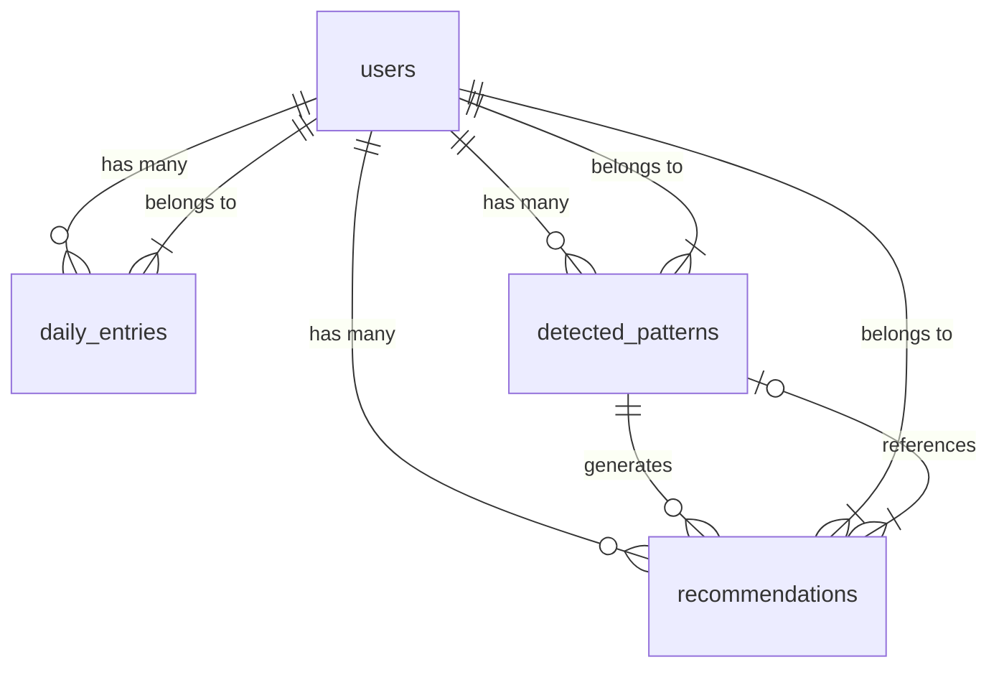

# Data Architecture Documentation

## Purpose and Scope

This document describes the data architecture of LifePatterns AI, including data sources, entities, storage technologies, schemas, validation rules, lifecycle, transformations, and privacy considerations.

**Scope:**

- Database schema and entity relationships
- Data storage technologies and persistence behavior
- Data formats and validation rules
- Data lifecycle and retention
- Data transformations and derived attributes
- Sensitive data handling
- External data transfers
- Data quality constraints

## Data Sources and Ownership

### Primary Data Sources

**User-Generated Data:**

- **Source**: Direct user input through Streamlit forms
- **Ownership**: Individual users (data isolated by user_id)
- **Collection**: Manual entry via Daily Input page
- **Frequency**: Daily (or as needed by user)

**External Data Sources:**

- **Groq API**: AI-powered NLP analysis (sentiment, emotions, keywords, topics)
- **Ownership**: Generated by application, stored with user data
- **Collection**: Automatic on journal entry submission
- **Frequency**: Per journal entry

**Planned but Not Implemented:**

- OpenWeatherMap API: Weather data for correlation analysis (documented but not integrated)

### Data Ownership Model

- **Multi-tenant isolation**: Each user's data is isolated via `user_id` foreign key
- **No cross-user data access**: All database queries include `user_id` filter
- **User control**: Users can export all their data via JSON export
- **User deletion**: CASCADE delete removes all user data on account deletion

## Data Entities, Schemas, and Relationships

### Entity Relationship Diagram



### Entity: users

**Purpose**: Store user account information and authentication credentials

**Table Schema**:

```sql
CREATE TABLE users (
    id SERIAL PRIMARY KEY,
    username VARCHAR(50) UNIQUE NOT NULL,
    email VARCHAR(100) UNIQUE,
    password_hash VARCHAR(255),
    created_at TIMESTAMP DEFAULT CURRENT_TIMESTAMP,
    updated_at TIMESTAMP DEFAULT CURRENT_TIMESTAMP,
    settings JSONB DEFAULT '{}'
);
```

**Columns**:

- `id`: Primary key, auto-incrementing integer
- `username`: Unique username (min 3 characters), case-insensitive lookup
- `email`: Optional unique email address, case-insensitive lookup
- `password_hash`: Bcrypt-hashed password (12 rounds)
- `created_at`: Account creation timestamp
- `updated_at`: Last update timestamp (auto-updated by trigger)
- `settings`: JSONB field for user preferences (currently empty/default)

**Constraints**:

- `username`: UNIQUE, NOT NULL
- `email`: UNIQUE, nullable
- `password_hash`: nullable (for future OAuth integration)

**Relationships**:

- One-to-many to `daily_entries` (CASCADE delete)
- One-to-many to `detected_patterns` (CASCADE delete)
- One-to-many to `recommendations` (CASCADE delete)

**Indexes**:

- Primary key on `id`
- Unique index on `username`
- Unique index on `email`

### Entity: daily_entries

**Purpose**: Store daily journal entries with metrics and AI analysis results

**Table Schema**:

```sql
CREATE TABLE daily_entries (
    id SERIAL PRIMARY KEY,
    user_id INTEGER REFERENCES users(id) ON DELETE CASCADE,
    entry_date DATE NOT NULL,
    journal_text TEXT,
    mood_rating INTEGER CHECK (mood_rating >= 1 AND mood_rating <= 10),
    energy_level INTEGER CHECK (energy_level >= 1 AND energy_level <= 10),
    sleep_hours DECIMAL(3,1),
    activities TEXT[],
    sentiment_score DECIMAL(3,2),
    sentiment_label VARCHAR(20),
    keywords TEXT[],
    emotions JSONB DEFAULT '{}',
    topics TEXT[],
    created_at TIMESTAMP DEFAULT CURRENT_TIMESTAMP,
    updated_at TIMESTAMP DEFAULT CURRENT_TIMESTAMP,
    UNIQUE(user_id, entry_date)
);
```

**Columns**:

- `id`: Primary key, auto-incrementing integer
- `user_id`: Foreign key to users table (CASCADE delete)
- `entry_date`: Date of the entry (UNIQUE constraint with user_id)
- `journal_text`: Free-text journal entry (plaintext, no encryption)
- `mood_rating`: User-reported mood (1-10 scale)
- `energy_level`: User-reported energy (1-10 scale)
- `sleep_hours`: Hours of sleep (decimal, 0.0-12.0)
- `activities`: Array of activity names (13 predefined options)
- `sentiment_score`: AI-calculated sentiment (-1.0 to 1.0)
- `sentiment_label`: Sentiment category (positive/negative/neutral)
- `keywords`: Extracted keywords from journal text
- `emotions`: JSONB object with emotion scores (joy, sadness, anger, fear, stress, calm)
- `topics`: Detected topics (work, relationships, health, mental_health, leisure, sleep)
- `created_at`: Entry creation timestamp
- `updated_at`: Last update timestamp (auto-updated by trigger)

**Important Note**: The fields `summary` and `insights` are generated during NLP analysis (when using Groq API) but are **NOT persisted** in the database schema. These are transient display-only outputs shown to the user after analysis but not stored in PostgreSQL.

**Constraints**:

- `user_id`: Foreign key, NOT NULL
- `entry_date`: NOT NULL
- `mood_rating`: CHECK constraint (1-10)
- `energy_level`: CHECK constraint (1-10)
- `UNIQUE(user_id, entry_date)`: One entry per user per day

**Relationships**:

- Many-to-one to `users` (CASCADE delete)

**Indexes**:

- Primary key on `id`
- Composite index on `(user_id, entry_date)` for query performance
- Index on `entry_date` for time-based queries

**UPSERT Behavior**:

- INSERT on conflict (user_id, entry_date) → UPDATE all fields
- Allows users to update their entry for a given date

### Entity: detected_patterns

**Purpose**: Store identified behavioral patterns from pattern detection

**Table Schema**:

```sql
CREATE TABLE detected_patterns (
    id SERIAL PRIMARY KEY,
    user_id INTEGER REFERENCES users(id) ON DELETE CASCADE,
    pattern_type VARCHAR(50) NOT NULL,
    pattern_name VARCHAR(100),
    description TEXT,
    confidence_score DECIMAL(3,2),
    detected_at TIMESTAMP DEFAULT CURRENT_TIMESTAMP,
    valid_until TIMESTAMP,
    pattern_data JSONB DEFAULT '{}',
    is_active BOOLEAN DEFAULT TRUE
);
```

**Columns**:

- `id`: Primary key, auto-incrementing integer
- `user_id`: Foreign key to users table (CASCADE delete)
- `pattern_type`: Type of pattern (mood_trend, sleep_mood_correlation, activity_impact)
- `pattern_name`: Human-readable pattern name
- `description`: Detailed description of the pattern
- `confidence_score`: Confidence score (0.0 to 1.0)
- `detected_at`: Timestamp when pattern was detected
- `valid_until`: Timestamp when pattern expires (NULL for indefinite)
- `pattern_data`: JSONB object with pattern-specific data
- `is_active`: Boolean flag for active/inactive status

**Constraints**:

- `user_id`: Foreign key, NOT NULL
- `pattern_type`: NOT NULL

**Relationships**:

- Many-to-one to `users` (CASCADE delete)
- One-to-many to `recommendations` (patterns generate recommendations)

**Indexes**:

- Primary key on `id`
- Composite index on `(user_id, is_active)` for active pattern queries

**Usage Note**:

- Pattern table exists in schema but is not actively populated by current implementation
- Patterns are calculated on-demand from entry data, not persisted

### Entity: recommendations

**Purpose**: Store personalized recommendations linked to detected patterns

**Table Schema**:

```sql
CREATE TABLE recommendations (
    id SERIAL PRIMARY KEY,
    user_id INTEGER REFERENCES users(id) ON DELETE CASCADE,
    pattern_id INTEGER REFERENCES detected_patterns(id),
    recommendation_text TEXT NOT NULL,
    category VARCHAR(50),
    expected_impact JSONB DEFAULT '{}',
    confidence_score DECIMAL(3,2),
    generated_at TIMESTAMP DEFAULT CURRENT_TIMESTAMP,
    accepted BOOLEAN,
    accepted_at TIMESTAMP,
    dismissed BOOLEAN DEFAULT FALSE
);
```

**Columns**:

- `id`: Primary key, auto-incrementing integer
- `user_id`: Foreign key to users table (CASCADE delete)
- `pattern_id`: Foreign key to detected_patterns (nullable)
- `recommendation_text`: Recommendation text content
- `category`: Recommendation category (mental_health, sleep, lifestyle, ai_insight)
- `expected_impact`: JSONB object with expected impact data
- `confidence_score`: Confidence score (0.0 to 1.0)
- `generated_at`: Timestamp when recommendation was generated
- `accepted`: Boolean flag for user acceptance
- `accepted_at`: Timestamp when user accepted recommendation
- `dismissed`: Boolean flag for dismissal status

**Constraints**:

- `user_id`: Foreign key, NOT NULL
- `pattern_id`: Foreign key, nullable
- `recommendation_text`: NOT NULL

**Relationships**:

- Many-to-one to `users` (CASCADE delete)
- Many-to-one to `detected_patterns` (nullable)

**Indexes**:

- Primary key on `id`
- Composite index on `(user_id, dismissed)` for query performance

**Usage Note**:

- Recommendation table exists in schema but is not actively populated by current implementation
- Recommendations are generated on-demand, not persisted

## Storage Technologies and Persistence Behavior

### Primary Storage: PostgreSQL 15

**Connection Management**:

- SQLAlchemy 2.0.23 ORM with raw SQL queries
- Connection string via `DATABASE_URL` or individual `DB_*` environment variables
- No connection pooling implemented (each query creates new connection)
- Connection testing utility in `data/database.py`

**Persistence Behavior**:

- ACID transactions guaranteed by PostgreSQL
- AUTOCOMMIT not used; explicit commit in `save_entry()`
- UPSERT operation for daily entries (INSERT ... ON CONFLICT DO UPDATE)
- CASCADE delete on user deletion (removes all related data)

**Data Formats**:

- **Plaintext**: `journal_text` stored as TEXT (no encryption)
- **Arrays**: `activities`, `keywords`, `topics` stored as TEXT[]
- **JSONB**: `settings`, `emotions`, `pattern_data`, `expected_impact` stored as JSONB
- **Numeric**: `mood_rating`, `energy_level` as INTEGER, `sleep_hours` as DECIMAL(3,1)
- **Temporal**: Dates as DATE, timestamps as TIMESTAMP

**JSONB Advantages**:

- Flexible schema for evolving data structures
- Efficient storage (binary format)
- Queryable JSON fields (not currently used)
- Automatic dict→JSONB conversion by SQLAlchemy

### No Secondary Storage

- **No caching layer**: Redis configured but not used
- **No file storage**: No file uploads or static data storage
- **No external object storage**: No S3 or similar integration

## Data Formats and Validation Rules

### Input Validation Rules

**User Registration**:

- Username: Minimum 3 characters, case-insensitive uniqueness
- Email: Optional, must be unique if provided, case-insensitive
- Password: Minimum 8 characters, bcrypt hashing with 12 rounds

**Daily Entry**:

- Date: Required, enforced by UNIQUE constraint with user_id
- Mood: 1-10 scale, enforced by CHECK constraint
- Energy: 1-10 scale, enforced by CHECK constraint
- Sleep: 0.0-12.0 hours, enforced by UI slider
- Activities: Multi-select from 13 predefined options
- Journal text: Required (non-empty), validated in UI before submission

### Data Type Constraints

**Numeric Ranges**:

- `mood_rating`: INTEGER, CHECK (1-10)
- `energy_level`: INTEGER, CHECK (1-10)
- `sleep_hours`: DECIMAL(3,1), UI limited to 0.0-12.0
- `sentiment_score`: DECIMAL(3,2), range -1.0 to 1.0
- `confidence_score`: DECIMAL(3,2), range 0.0 to 1.0

**String Lengths**:

- `username`: VARCHAR(50)
- `email`: VARCHAR(100)
- `sentiment_label`: VARCHAR(20)
- `pattern_type`: VARCHAR(50)
- `pattern_name`: VARCHAR(100)
- `category`: VARCHAR(50)

**Array Constraints**:

- `activities`: TEXT[] (no size limit, 13 predefined options)
- `keywords`: TEXT[] (no size limit, typically 5-10)
- `topics`: TEXT[] (no size limit, typically 3-5)

### JSONB Schema (Informal)

**users.settings**:

```json
{
  // Currently empty/default
  // Future: user preferences, theme, notification settings
}
```

**daily_entries.emotions**:

```json
{
  "joy": 0.0,
  "sadness": 0.0,
  "anger": 0.0,
  "fear": 0.0,
  "stress": 0.0,
  "calm": 0.0
}
```

**detected_patterns.pattern_data**:

```json
{
  // Pattern-specific data
  // Example for mood_trend: {"trend": "improving", "change": "+1.5"}
}
```

**recommendations.expected_impact**:

```json
{
  // Expected impact data
  // Example: {"mood_improvement": "+1.5", "timeframe": "3-5 days"}
}
```

## Data Lifecycle and Retention

### Data Creation

**User Account**:

- Created on registration via `AuthManager.register_user()`
- Timestamp: `created_at` set to CURRENT_TIMESTAMP
- No expiration or automatic deletion

**Daily Entry**:

- Created on form submission via `save_entry()`
- Timestamp: `created_at` set to CURRENT_TIMESTAMP
- UPSERT: Updates existing entry if (user_id, entry_date) already exists
- No automatic expiration

**Detected Pattern**:

- Created on pattern detection (not currently persisted)
- Timestamp: `detected_at` set to CURRENT_TIMESTAMP
- Optional `valid_until` for pattern expiration (not used)

**Recommendation**:

- Created on recommendation generation (not currently persisted)
- Timestamp: `generated_at` set to CURRENT_TIMESTAMP
- Optional `accepted_at` when user accepts (not implemented)

### Data Updates

**User Account**:

- Password updates via `AuthManager.change_password()`
- `updated_at` auto-updated by trigger
- Settings updates not implemented

**Daily Entry**:

- UPSERT operation updates all fields on (user_id, entry_date) conflict
- `updated_at` auto-updated by trigger
- No version history (current value only)

### Data Deletion

**User Deletion**:

- CASCADE delete on user_id removes all related data
- Triggered by `AuthManager.delete_user()` with password verification
- No soft delete or archival

**Data Retention Policy**:

- **Not implemented**: No automated data retention or expiration
- **No archival**: No cold storage or archival mechanism
- **Manual deletion**: Users can delete account (removes all data)
- **No data export to external**: Export only to JSON (user-controlled)

### Data Export

**Export Functionality**:

- Implemented in `get_all_entries_for_export(user_id)`
- Returns all entries for a user as list of dictionaries
- Includes: entry_date, mood, energy, sleep, activities, sentiment, keywords, journal_text, emotions, topics, created_at
- Exported as JSON via Streamlit download button
- No automated or scheduled exports

## Data Transformations and Derived Attributes

### NLP-Derived Attributes

**Sentiment Analysis** (from journal_text):

- **Input**: Free-text journal entry
- **Processing**: Groq API (primary) or TextBlob (fallback)
- **Output**:
  - `sentiment_score`: DECIMAL(3,2), range -1.0 to 1.0
  - `sentiment_label`: VARCHAR(20), values (positive/negative/neutral)
- **Transformation**: Text → numeric score + category label
- **Storage**: Stored in `daily_entries` alongside original text

**Emotion Detection** (from journal_text):

- **Input**: Free-text journal entry
- **Processing**: Groq API (primary) or keyword matching (fallback)
- **Output**: JSONB object with 6 emotion scores (0.0 to 1.0)
- **Transformation**: Text → emotion scores via keyword frequency or AI
- **Storage**: Stored in `daily_entries.emotions` JSONB field

**Keyword Extraction** (from journal_text):

- **Input**: Free-text journal entry
- **Processing**: Frequency analysis with stop word filtering
- **Output**: Array of 5-10 keywords (4+ letter words)
- **Transformation**: Text → keyword array
- **Storage**: Stored in `daily_entries.keywords` TEXT[] field

**Topic Classification** (from journal_text):

- **Input**: Free-text journal entry
- **Processing**: Keyword matching against topic categories
- **Output**: Array of 3-5 topics (work, relationships, health, mental_health, leisure, sleep)
- **Transformation**: Text → topic array
- **Storage**: Stored in `daily_entries.topics` TEXT[] field

### Statistically-Derived Attributes

**User Statistics** (from daily_entries):

- **Input**: User's daily entries
- **Processing**: SQL aggregation (AVG, COUNT)
- **Output**:
  - `total_entries`: Count of entries
  - `avg_mood`: Average mood rating
  - `avg_energy`: Average energy level
  - `avg_sleep`: Average sleep hours
- **Transformation**: Row-level data → aggregated statistics
- **Storage**: Not persisted (calculated on-demand)

**Pattern Detection** (from daily_entries):

- **Input**: User's daily entries
- **Processing**: Statistical analysis in `PatternDetector` class
- **Output**: Pattern objects with type, name, confidence, description
- **Transformation**: Time-series data → pattern classifications
- **Storage**: Not persisted (calculated on-demand)

**Forecasting** (from daily_entries + patterns):

- **Input**: User's daily entries + detected patterns
- **Processing**: Linear extrapolation in `ForecastEngine` class
- **Output**: Forecast with status, trajectory, risks, predictions, interventions
- **Transformation**: Historical data → future predictions
- **Storage**: Not persisted (calculated on-demand)

## Sensitive Data Considerations

### Personal Identifiable Information (PII)

**Stored PII**:

- `username`: Not PII (pseudonym)
- `email`: PII (optional, stored in plaintext)
- `journal_text`: Potentially sensitive (stored in plaintext, no encryption)

**Encryption Status**:

- **Not implemented**: Data encryption at rest is documented but not implemented
- `ENCRYPT_DATA` and `ENCRYPTION_KEY` environment variables exist but are not used
- Journal entries stored in plaintext in PostgreSQL
- Email addresses stored in plaintext

**Recommendations**:

- Implement encryption at rest for journal_text and email
- Use database-level encryption or application-level encryption
- Enable SSL for database connections (DB_SSL_MODE documented but not enforced)

### Data Isolation

**User Isolation Mechanism**:

- All database queries include `user_id` filter
- Foreign key constraints enforce referential integrity
- CASCADE delete prevents orphaned data
- No cross-user data aggregation or sharing

**Isolation Enforcement**:

- **Application level**: All database functions require `user_id` parameter
- **Database level**: Foreign key constraints and CASCADE delete
- **No row-level security**: No PostgreSQL RLS policies (relying on application-level isolation)

**Risk**: Developer error could bypass isolation if `user_id` parameter is omitted or hardcoded

### Access Control

**Authentication Required**:

- All data access requires authenticated session
- JWT tokens with 30-day expiration
- Session state managed by Streamlit

**Authorization**:

- Users can only access their own data (enforced by `user_id` filter)
- No admin roles or elevated permissions
- No data sharing between users

## External Data Transfers

### Groq API

**Data Sent to Groq**:

- Journal text content (plaintext)
- Context data for recommendations (mood averages, pattern names)

**Data Received from Groq**:

- Sentiment analysis results (JSON)
- Emotion scores (JSON)
- Keywords and topics (JSON)
- AI-generated insights (JSON)

**Transfer Security**:

- HTTPS connection (handled by Groq SDK)
- API key authentication via environment variable
- No data sent beyond journal text and aggregated statistics

**Data Retention by Groq**:

- Groq's data retention policy applies (see Groq documentation)
- No control over Groq's data handling

### User Data Export

**Export Method**:

- Manual download via Streamlit UI
- Export format: JSON
- Export scope: All entries for authenticated user
- Transfer: Browser download (direct to user device)

**No Automated Exports**:

- No scheduled exports
- No external API for data retrieval
- No third-party integrations

## Data Quality Constraints

### Completeness Constraints

**Required Fields**:

- `users.username`: NOT NULL
- `daily_entries.user_id`: NOT NULL
- `daily_entries.entry_date`: NOT NULL
- `daily_entries.journal_text`: Validated in UI (non-empty)

**Optional Fields**:

- `users.email`: Nullable
- `daily_entries.mood_rating`: Nullable (but UI requires 1-10)
- `daily_entries.energy_level`: Nullable (but UI requires 1-10)
- `daily_entries.sleep_hours`: Nullable
- `daily_entries.activities`: Nullable (empty array if none selected)
- `daily_entries.sentiment_score`: Nullable (if NLP fails)
- `daily_entries.emotions`: Nullable (if NLP fails)

### Consistency Constraints

**Referential Integrity**:

- Foreign key constraints enforced by PostgreSQL
- CASCADE delete on user deletion
- No orphaned records possible

**Unique Constraints**:

- `users.username`: UNIQUE
- `users.email`: UNIQUE (if provided)
- `daily_entries(user_id, entry_date)`: UNIQUE (one entry per day per user)

**Check Constraints**:

- `daily_entries.mood_rating`: CHECK (1-10)
- `daily_entries.energy_level`: CHECK (1-10)

### Accuracy Constraints

**No Data Validation**:

- No validation of mood/energy/sleep reasonableness (e.g., sleep = 25 hours)
- No outlier detection
- No cross-field validation (e.g., mood vs sentiment consistency)

**NLP Accuracy**:

- No ground truth for sentiment/emotion accuracy
- No user feedback on NLP quality
- AI output quality depends on Groq model performance

## Schema Evolution and Migration Strategy

### Current Migration Strategy

**Manual SQL Scripts**:

- Database setup via `utils/setup_postgres.sql`
- Manual execution required for schema changes
- No version control of schema changes
- No rollback mechanism

**Alembic Not Used**:

- Alembic 1.12.1 installed but not configured
- No migration files
- No automated schema versioning

### Schema Changes History

**Initial Schema** (current):

- Created via `utils/setup_postgres.sql`
- Tables: users, daily_entries, detected_patterns, recommendations
- Indexes: Basic performance indexes
- Triggers: `updated_at` auto-update trigger

**No Schema Evolution**:

- No schema changes since initial creation
- No migration history
- No planned schema changes documented

### Recommended Migration Strategy

**Future Improvements**:

- Configure Alembic for automated migrations
- Version control all schema changes
- Implement migration testing
- Add rollback capability
- Document breaking changes

**Migration Process** (if implementing Alembic):

1. Generate initial migration from current schema
2. Apply migration to development database
3. Test migration on test data
4. Document migration in release notes
5. Apply to production with backup
6. Verify data integrity post-migration

## Views for Common Queries

### daily_summary View

**Purpose**: Pre-aggregated summary of recent entries (last 30 days)

**Definition**:

```sql
CREATE OR REPLACE VIEW daily_summary AS
SELECT
    user_id,
    entry_date,
    mood_rating,
    energy_level,
    sleep_hours,
    sentiment_score,
    activities
FROM daily_entries
WHERE entry_date >= CURRENT_DATE - INTERVAL '30 days';
```

**Usage**: Not actively used in application (queries use `get_entries()` directly)

### pattern_statistics View

**Purpose**: Aggregated pattern statistics by user and type

**Definition**:

```sql
CREATE OR REPLACE VIEW pattern_statistics AS
SELECT
    user_id,
    pattern_type,
    COUNT(*) as pattern_count,
    AVG(confidence_score) as avg_confidence
FROM detected_patterns
WHERE is_active = TRUE
GROUP BY user_id, pattern_type;
```

**Usage**: Not actively used in application (patterns calculated on-demand)

## Database Triggers

### update_updated_at_column Function

**Purpose**: Automatically update `updated_at` timestamp on row updates

**Definition**:

```sql
CREATE OR REPLACE FUNCTION update_updated_at_column()
RETURNS TRIGGER AS $$
BEGIN
    NEW.updated_at = CURRENT_TIMESTAMP;
    RETURN NEW;
END;
$$ language 'plpgsql';
```

### Triggers Applied

**users table**:

```sql
CREATE TRIGGER update_users_updated_at BEFORE UPDATE ON users
    FOR EACH ROW EXECUTE FUNCTION update_updated_at_column();
```

**daily_entries table**:

```sql
CREATE TRIGGER update_entries_updated_at BEFORE UPDATE ON daily_entries
    FOR EACH ROW EXECUTE FUNCTION update_updated_at_column();
```

**Behavior**: Automatically sets `updated_at` to CURRENT_TIMESTAMP on any UPDATE operation
