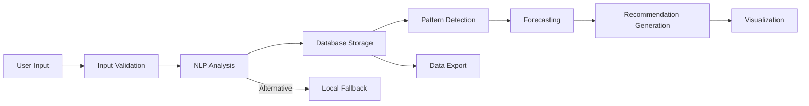

# Data Processing Pipeline Documentation

## Purpose and Scope

This document describes the actual data processing pipeline of LifePatterns AI, from user input to final output. It covers all implemented stages, including input validation, NLP analysis, pattern detection, forecasting, recommendation generation, and visualization.

**Scope:**

- Input sources and validation
- Data cleaning and preprocessing
- Feature extraction and transformations
- Model input preparation
- Inference and computation
- Output validation and postprocessing
- Storage and presentation
- Error handling at each stage
- Known limitations

## Pipeline Overview

## Stage 1: Input Sources

### Source: Daily Input Form

**Location**: `pages/Daily_Input.py`

**Input Fields**:

- `entry_date`: Date picker (default: today)
- `mood`: Slider (1-10 scale)
- `energy`: Slider (1-10 scale)
- `sleep`: Number input (0.0-12.0 hours, 0.5 increments)
- `activities`: Multi-select (13 predefined options)
- `journal_text`: Text area (free-form journal entry)

**Input Context**:

- User must be authenticated (session state check)
- User ID obtained from session state
- Form submitted via "Save Entry" button

**Purpose**: Collect daily behavioral data and journal content for analysis

## Stage 2: Input Validation

### Validation Implementation

**Location**: `pages/Daily_Input.py` (lines 74-77)

**Validation Rules**:

1. **Journal text non-empty**: `if not journal.strip()` → warning, return early
2. **Mood range**: Enforced by Streamlit slider (1-10)
3. **Energy range**: Enforced by Streamlit slider (1-10)
4. **Sleep range**: Enforced by Streamlit number input (0.0-12.0)
5. **Activities**: Multi-select from predefined list (no custom values)

**Validation Behavior**:

- **Failed validation**: Warning message displayed, function returns early
- **Passed validation**: Proceeds to NLP analysis

**Error Handling**:

- No exception handling for validation (Streamlit UI handles invalid inputs)
- No server-side validation beyond non-empty check

**Known Limitations**:

- No validation of mood/energy/sleep reasonableness (e.g., sleep = 25 hours would be rejected by UI range)
- No cross-field validation (e.g., mood vs sentiment consistency)
- No validation of journal text length or content

## Stage 3: Data Cleaning

### Implemented Cleaning

**Location**: Minimal explicit cleaning implemented

**Cleaning Operations**:

1. **Whitespace trimming**: `journal.strip()` for non-empty check
2. **Text case normalization**: `text.lower()` in NLP processor for case-insensitive matching
3. **Punctuation removal**: Regex extraction in keyword extraction `r'\b[a-zA-Z]{4,}\b'`

**Not Implemented**:

- No HTML sanitization (not needed, no rich text input)
- No profanity filtering
- No personal information redaction
- No text normalization beyond lowercase
- No spell checking or correction

**Assumptions**:

- User input is trusted (no malicious input expected)
- Journal text is in English (no language detection)
- Punctuation and special characters handled by regex

## Stage 4: NLP Analysis

### Implementation Location

**Primary**: `models/nlp_processor.py` (integrated in `pages/Daily_Input.py`)

**Integration**: The `Daily_Input.py` page now imports and uses `NLPProcessor` from `models/nlp_processor.py` for journal entry analysis. The previous local `analyze_text()` function has been removed.

### Processing Steps

**Option A: Groq API (Primary if Enabled)**

_Location_: `models/nlp_processor.py`, method `_ai_analyze()`

**Activation Condition**: `ENABLE_EXTERNAL_AI=true` (default) AND `GROQ_API_KEY` is set

**Input**: Journal text string

**Processing**:

1. Create structured prompt with JSON output format
2. Send request to Groq API (model: llama-3.1-8b-instant)
3. Parse JSON response
4. Extract: sentiment_score, sentiment_label, emotions, keywords, topics, summary, insights
5. Validate and set defaults for missing fields

**Output**: Dictionary with:

- `sentiment_score`: float (-1.0 to 1.0)
- `sentiment_label`: str (positive/negative/neutral)
- `emotions`: dict (6 emotion scores 0.0-1.0)
- `keywords`: list (5-10 keywords)
- `topics`: list (3-5 topics)
- `summary`: str (2-3 sentence summary)
- `insights`: list (2-3 behavioral insights)

**Configuration**:

- Temperature: 0.3 (for consistency)
- Max tokens: 500
- Response format: JSON object
- Environment variable: `ENABLE_EXTERNAL_AI=false` (secure-by-default)
- Requires: Operator configuration (`ENABLE_EXTERNAL_AI=true`) AND explicit user consent via UI checkbox

**Error Handling**:

- API failure: Falls back to local analysis
- Invalid JSON: Uses default values
- Missing fields: Uses defaults from `_default_emotions()`
- Timeout: Falls back to local analysis

**Option B: TextBlob (Local Fallback)**

_Location_: `models/nlp_processor.py`, method `_local_analyze()`

**Activation Condition**: Groq API unavailable OR `ENABLE_EXTERNAL_AI=false` OR `GROQ_API_KEY` not set

**Input**: Journal text string

**Processing**:

1. TextBlob sentiment analysis (polarity, subjectivity) if available
2. Emotion detection via keyword matching
3. Keyword extraction via frequency analysis
4. Topic detection via keyword matching
5. Summary generation (first sentence or first 100 chars)
6. Insights generation based on emotion thresholds

**Output**: Same structure as Groq API

**Error Handling**:

- TextBlob unavailable: Falls back to keyword-based sentiment
- No specific error handling for TextBlob failures

**Option C: Keyword-Based Analysis (Tertiary Fallback)**

_Location_: `models/nlp_processor.py`, method `_calculate_sentiment()`

**Activation Condition**: TextBlob unavailable

**Input**: Journal text string

**Processing**:

1. Convert to lowercase
2. Count positive/negative keyword occurrences
3. Calculate sentiment score: `(pos - neg) / total`
4. Determine sentiment label based on thresholds (> 0.2 positive, < -0.2 negative)
5. Calculate emotion scores based on keyword presence (frequency-based 0.0-1.0)
6. Extract keywords via regex (4+ letter words, filter stop words)
7. Detect topics via keyword matching (work, relationships, health, etc.)

**Output**: Dictionary with:

- `sentiment_score`: float (rounded to 2 decimals)
- `sentiment_label`: str (positive/negative/neutral)
- `emotions`: dict (6 emotion scores, float 0.0-1.0)
- `keywords`: list (up to 8 keywords)
- `topics`: list (1-4 topics)
- `summary`: str (generated from first sentence)
- `insights`: list (rule-based insights)

**Assumptions**:

- Keyword matching sufficient for basic sentiment
- Limited emotion vocabulary (6 emotions)
- Topics limited to predefined categories

**Known Limitations**:

- No contextual understanding
- No nuance detection
- Limited emotion vocabulary
- Summary and insights are simple/template-based

## Stage 5: Feature Extraction

### Implemented Features

**From NLP Analysis**:

- Sentiment score (numeric -1.0 to 1.0)
- Sentiment label (categorical)
- Emotion scores (6 numeric features)
- Keywords (text array)
- Topics (categorical array)

**From User Input**:

- Mood rating (numeric 1-10)
- Energy level (numeric 1-10)
- Sleep hours (numeric 0.0-12.0)
- Activities (categorical array)
- Entry date (temporal)

**Derived Features** (Calculated Later):

- Weekly averages (mood, energy, sleep)
- Mood trend (improving/declining/stable)
- Sleep-mood correlation
- Activity impact scores
- Rolling averages (3-day window)

### Feature Engineering

**Not Implemented**:

- No feature scaling or normalization
- No one-hot encoding for activities
- No time-based features (day of week, month, season)
- No lag features (previous day's mood)
- No interaction features (mood × sleep)
- No polynomial features
- No dimensionality reduction

**Assumptions**:

- Raw features sufficient for current analysis
- No need for complex feature engineering with simple statistical methods

## Stage 6: Model Input Preparation

### Current Implementation

**Pattern Detection Input**:

- Location: `models/pattern_detector.py`
- Input: List of Entry objects from database
- Preparation: Direct use of Entry object attributes
- No additional preprocessing

**Forecast Engine Input**:

- Location: `models/forecast_engine.py`
- Input: List of Entry objects + detected patterns
- Preparation: Direct use of Entry object attributes
- No additional preprocessing

**Visualization Input**:

- Location: `components/visualizations.py`
- Input: List of Entry objects
- Preparation: Convert to pandas DataFrame, sort by date
- No additional preprocessing

### Not Implemented

- No train/test split (no model training)
- No feature scaling
- No missing value imputation (beyond default values)
- No data augmentation
- No batch processing (all entries processed at once)

## Stage 7: Inference and Computation

### Pattern Detection

**Location**: `models/pattern_detector.py`

**Algorithm 1: Mood Trend Detection**

- Input: List of entries with mood ratings
- Minimum data: 3 entries
- Method: Split data into two halves, compare averages
- Threshold: Difference > 0.5 for significant trend
- Output: Pattern object with trend direction, change magnitude, confidence

**Algorithm 2: Sleep-Mood Correlation**

- Input: List of entries with sleep hours and mood ratings
- Minimum data: 5 entries
- Method: Compare average mood for good sleep (7h+) vs poor sleep (<6h)
- Threshold: Difference > 1.0 for significant correlation
- Output: Pattern object with correlation description, confidence

**Algorithm 3: Activity Impact**

- Input: List of entries with activities and mood ratings
- Minimum data: 2 entries per activity
- Method: Calculate average mood per activity, find highest
- Threshold: Average mood > 6.0 for positive impact
- Output: Pattern object with activity name, average mood, confidence

**Characteristics**:

- No statistical significance testing
- No confidence intervals
- Simple heuristic thresholds
- Linear relationships assumed

### Forecasting

**Location**: `models/forecast_engine.py`

**Algorithm 1: Status Assessment**

- Input: Last 3 entries (mood, energy)
- Method: Calculate averages, apply thresholds
- Thresholds: mood >= 7 & energy >= 6 = Thriving
- Output: Status category (Thriving/Stable/Struggling/Critical)

**Algorithm 2: Trajectory Prediction**

- Input: All entries with mood ratings
- Minimum data: 3 entries
- Method: Compare first half vs second half average
- Threshold: Difference > 0.5 for significant trend
- Output: Direction (improving/declining/stable), change magnitude, confidence

**Algorithm 3: Risk Assessment**

- Input: All entries
- Method: Rule-based checks
  - Declining trajectory: mood_decline risk
  - Low mood streak (2+ days < 4): depression_risk
  - Sleep deprivation (3+ days < 6h): burnout_risk
- Output: List of risk objects with type, level, description, probability

**Algorithm 4: 7-Day Forecast**

- Input: Current mood + trajectory
- Method: Linear extrapolation with decreasing confidence
- Formula: `predicted_mood = current_mood + (change * day / 7)`
- Confidence: Decays from 0.9 to 0.5 over 7 days
- Output: Daily predictions with mood and confidence

**Characteristics**:

- No machine learning models
- Linear extrapolation assumes constant trend
- No uncertainty quantification beyond confidence decay
- No seasonal adjustment

### Recommendation Generation

**Location**: `models/recommendation_engine.py`

**Algorithm 1: Mood-Based Recommendations**

- Input: Detected mood trend pattern
- Method: Rule-based mapping
  - Declining: Meditation, walk suggestions
  - Improving: Journal positive patterns
  - Stable: No recommendation
- Output: Recommendation object with action, expected impact, priority

**Algorithm 2: Sleep-Based Recommendations**

- Input: Sleep-mood correlation or sleep deficit
- Method: Rule-based mapping
  - Correlation detected: Prioritize 7-8 hours sleep
  - Sleep deficit: Go to bed 30 minutes earlier
- Output: Recommendation object with action, expected impact, priority

**Algorithm 3: Activity-Based Recommendations**

- Input: Positive activity impact pattern
- Method: Rule-based mapping
  - Positive activity detected: Do more of that activity
- Output: Recommendation object with action, expected impact, priority

**Algorithm 4: AI Recommendations (Optional)**

- Input: Recent data + patterns
- Method: Groq API call with structured prompt
- Minimum data: 3 entries
- Output: AI-generated recommendation with title, action, rationale, expected impact

**Characteristics**:

- Rule-based logic for primary recommendations
- Optional AI enhancement
- No learning from user behavior
- No personalization beyond data

## Stage 8: Output Validation and Postprocessing

### Validation

**Pattern Detection Output**:

- Minimum data check: Returns None if insufficient data
- Threshold check: Returns None if threshold not met
- No additional validation

**Forecast Output**:

- Minimum data check: Returns None if < 3 entries
- Range clamping: Predicted mood clamped to 1-10 range
- No additional validation

**Recommendation Output**:

- Pattern check: Returns None if no pattern detected
- AI fallback: Returns None if Groq API fails
- No additional validation

### Postprocessing

**NLP Output**:

- Default values for missing fields
- Rounding of sentiment scores (2 decimals)
- Empty arrays for missing keywords/topics

**Pattern Output**:

- Confidence calculation: `min(abs(diff) / 2, 1.0)`
- String formatting: Change magnitude with +/- prefix

**Forecast Output**:

- Rounding of averages (1 decimal)
- Confidence decay calculation: `max(0.9 - (day * 0.05), 0.5)`

**Visualization Output**:

- Color coding based on thresholds (green >= 7, yellow >= 5, red < 5)
- Sorting activities by average mood
- Rolling average calculation (3-day window)

## Stage 9: Storage

### Database Storage

**Location**: `utils/database.py`, function `save_entry()`

**Storage Operation**:

- UPSERT: INSERT or UPDATE on (user_id, entry_date) conflict
- All fields stored in single transaction
- SQLAlchemy automatic dict→JSONB conversion

**Stored Data**:

- User metadata: user_id, entry_date
- User input: journal_text, mood_rating, energy_level, sleep_hours, activities
- NLP output: sentiment_score, sentiment_label, emotions, keywords, topics
- Timestamps: created_at, updated_at (auto-generated)

**Not Stored**:

- Detected patterns (calculated on-demand)
- Forecasts (calculated on-demand)
- Recommendations (calculated on-demand)

**Error Handling**:

- Database errors: Returns False, logs error
- No retry logic
- No partial data storage

## Stage 10: Presentation

### Visualization

**Location**: `components/visualizations.py`

**Chart Types**:

1. **Mood Trend Chart**: Line chart with mood, energy, and rolling average
2. **Activity Impact Chart**: Bar chart of average mood by activity
3. **Sleep-Mood Correlation**: Scatter plot with OLS trend line
4. **Sentiment Timeline**: Line chart of sentiment scores over time
5. **Weekly Summary**: Table of weekly statistics

**Presentation Features**:

- Interactive Plotly charts
- Dark theme styling
- Hover tooltips
- Color coding based on thresholds
- Dynamic updates based on available data

**Data Export**:

- Location: `utils/database.py`, function `get_all_entries_for_export()`
- Format: JSON
- Scope: All entries for authenticated user
- User-triggered via download button

## Missing or Non-Existent Stages

### Not Implemented

1. **Data Augmentation**: No synthetic data generation
2. **Feature Selection**: No automated feature selection
3. **Model Training**: No machine learning model training
4. **Model Evaluation**: No evaluation metrics calculated
5. **Batch Processing**: All processing is real-time, on-demand
6. **Real-Time Processing**: No streaming or event-based processing
7. **Data Quality Checks**: No automated data quality validation
8. **Anomaly Detection**: No outlier detection
9. **Data Normalization**: No feature scaling or normalization
10. **Dimensionality Reduction**: No PCA or similar techniques

## Error Handling Summary

### NLP Analysis Errors

**External AI Disabled**:

- Handling: Local TextBlob or keyword-based analysis used immediately
- User Impact: No data sent externally, local analysis only
- Configuration: `ENABLE_EXTERNAL_AI=false` or `GROQ_API_KEY` not set

**Groq API Failure**:

- Handling: Automatic fallback to TextBlob or keyword-based analysis
- User Impact: Reduced functionality (less sophisticated analysis)
- Logging: Print statement to console

**TextBlob Unavailable**:

- Handling: Fallback to keyword-based sentiment calculation
- User Impact: Reduced functionality (basic sentiment only)
- Logging: None (TEXTBLOB_AVAILABLE flag checked at import)

**Empty Input**:

- Handling: Returns empty result structure with neutral values
- User Impact: Analysis with neutral/zero values
- Logging: None

**Timeout or Network Error**:

- Handling: Falls back to local analysis
- User Impact: Journal entry saved with local analysis
- Logging: Print statement to console

### Pattern Detection Errors

**Insufficient Data**:

- Handling: Returns None (no pattern detected)
- User Impact: No pattern displayed
- Logging: None

**Missing Fields**:

- Handling: Skips entries with missing required data
- User Impact: Pattern based on available data only
- Logging: None

### Forecasting Errors

**Insufficient Data**:

- Handling: Returns None (no forecast)
- User Impact: No forecast displayed
- Logging: None

**AI Forecast Failure**:

- Handling: Continues with rule-based forecast
- User Impact: Forecast without AI insights
- Logging: Print statement to console

### Database Errors

**Connection Failure**:

- Handling: Returns False, logs error
- User Impact: Operation fails, error message displayed
- Logging: Print statement to console

**Query Errors**:

- Handling: Returns False, logs error
- User Impact: Operation fails, error message displayed
- Logging: Print statement to console

**Constraint Violations**:

- Handling: Database-level error propagated
- User Impact: Operation fails, error message displayed
- Logging: Print statement to console

## Known Limitations

### Data Quality

- No validation of data reasonableness (e.g., sleep = 25 hours)
- No outlier detection
- No consistency checks between related fields
- No data cleaning beyond basic text normalization

### NLP Quality

- NLP processor module integrated into entry submission
- External AI (Groq) used when enabled with user consent and API key available
- Local TextBlob/keyword-based fallback when external AI disabled, unavailable, or consent not granted
- No ground truth for sentiment/emotion accuracy
- No user feedback on NLP quality
- Limited emotion vocabulary (6 emotions)
- Summary and insights from external AI are transient display-only outputs, not persisted in database

### Pattern Detection

- Simple heuristic thresholds (no statistical significance)
- Assumes linear relationships
- No time-aware analysis (all entries treated equally)
- No seasonal or periodic pattern detection
- Minimum data requirements may be too low for reliable patterns

### Forecasting

- Linear extrapolation assumes constant trend
- No confidence intervals or uncertainty quantification
- No seasonal adjustment
- Forecast accuracy not validated
- No comparison with actual future data

### Recommendations

- Rule-based logic (not personalized beyond data)
- No learning from user behavior
- No user feedback on recommendation quality
- No A/B testing of effectiveness
- Limited recommendation variety

### Performance

- No caching (all calculations repeated on each page load)
- No batch processing (all entries loaded into memory)
- No query optimization beyond basic indexes
- No connection pooling

## Implementation Inconsistencies

### NLP Processor Integration Status

**Status**: Resolved

**Resolution**: The `models/nlp_processor.py` module is now integrated into `pages/Daily_Input.py`. The previous local `analyze_text()` function has been removed. The entry submission flow now uses the sophisticated NLP processor with Groq API integration, TextBlob fallback, and comprehensive emotion detection.

**Configuration**:

- External AI processing controlled by `ENABLE_EXTERNAL_AI` environment variable (default: true)
- Groq API key required for external AI (`GROQ_API_KEY`)
- Automatic fallback to local TextBlob/keyword-based analysis when external AI disabled or unavailable

**Data Storage**:

- Summary and insights fields from external AI are displayed to users but not stored in database
- Core fields (sentiment_score, sentiment_label, emotions, keywords, topics) are stored as before
- No database schema migration required
